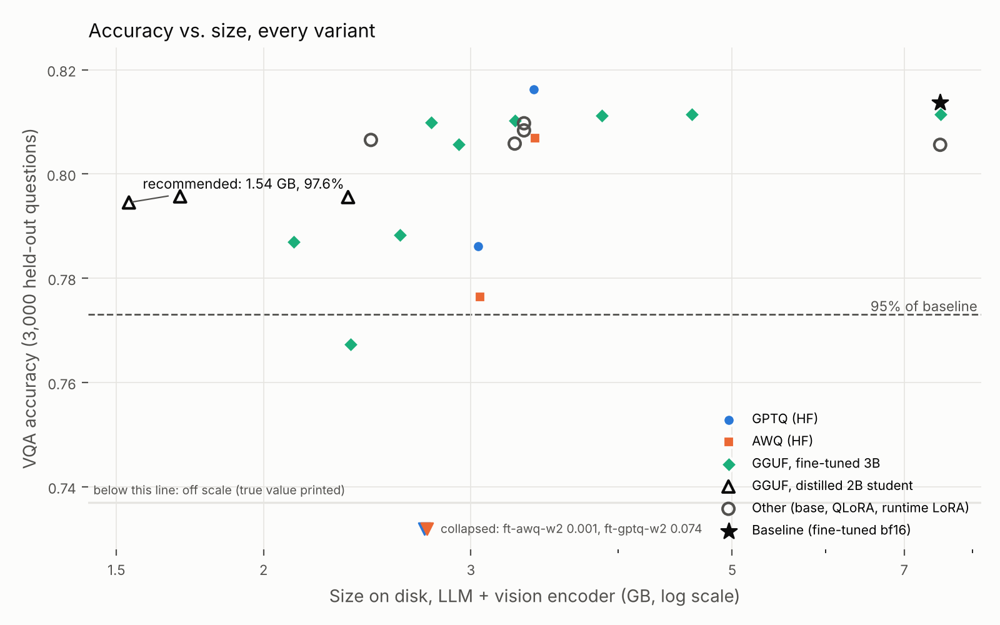
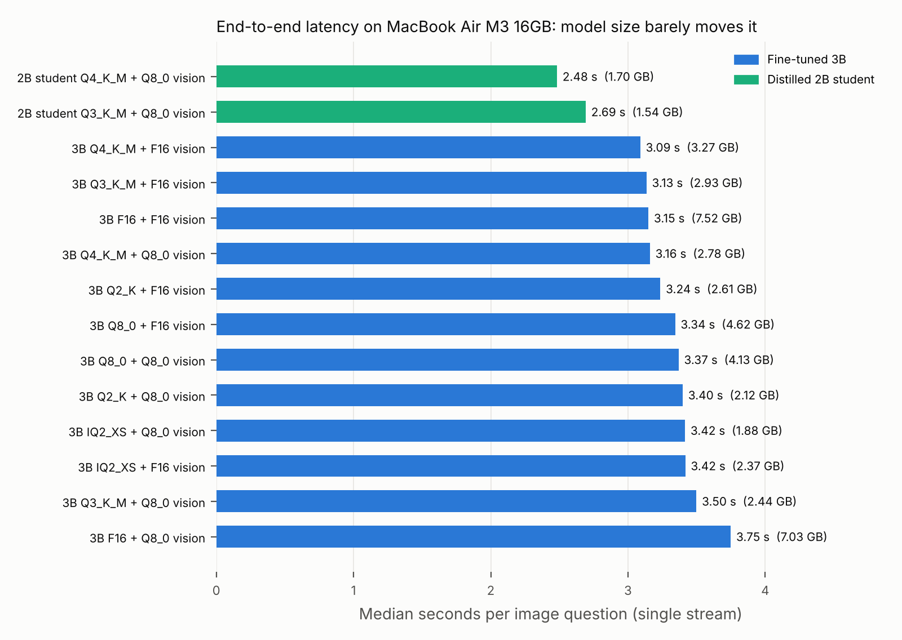

# PocketVLM: Compressing a Vision-Language Model to Run on a Laptop

**Question:** How small can a fine-tuned vision-language model get before accuracy breaks?

**Build:** LoRA fine-tune Qwen2.5-VL-3B-Instruct on VQAv2, then compress it four ways and measure every variant against the full-precision fine-tuned model:

| Path | What it tests | Variants |
|---|---|---|
| GPTQ (llm-compressor) | second-order PTQ | W4 / W3 / W2 |
| AWQ (llm-compressor) | activation-aware PTQ | W4 / W3 / W2 |
| GGUF (llama.cpp, imatrix) | the format that actually runs on a laptop | Q8_0, Q6_K, Q4_K_M, Q3_K_M, Q2_K, IQ2_XS, each with mmproj F16 or Q8_0 |
| LoRA x quantization | merge-then-quantize vs quantize-then-adapt | merged FT -> Q4_K_M; base Q4_K_M + runtime LoRA; base Q4_K_M + QLoRA adapter; NF4 + QLoRA (HF) |
| Distillation | is a distilled smaller model better than a crushed bigger one at equal size? | FT 3B teacher -> Qwen2-VL-2B student (KL + CE), then Q8_0 / Q4_K_M / Q3_K_M |

**Baseline:** the full-precision (bf16) fine-tuned model. **On device:** llama.cpp (Metal) on an Apple Silicon Mac, with a live demo of the recommended configuration.

All compression here is post-training quantization (plus QLoRA, which trains against a 4-bit base). Full quantization-aware training and ONNX export are out of scope; the doc allows GGUF *or* ONNX.

## Results

> **Shrank the model 4.9x (7.51 GB to 1.54 GB) while keeping 97.6% of VQA accuracy, running at 41.6 tokens/s and 2.7 s per image question on a MacBook Air M3.**
>
> Recommended: distilled Qwen2-VL-2B student, GGUF Q3_K_M, Q8_0 vision encoder. Keeping the original 3B architecture, the best is 3.5x smaller (2.12 GB, GGUF Q2_K) at 96.7%.

Baseline: fine-tuned Qwen2.5-VL-3B in bf16, VQA accuracy 0.8137 on 3,000 held-out VQAv2 questions (base model before LoRA: 0.8056).

| Variant | Size (GB) | VQA acc | % of baseline | MacBook Air M3: s / question | decode tok/s |
|---|---:|---:|---:|---:|---:|
| Fine-tuned 3B, bf16 (baseline) | 7.51 | 0.8137 | 100.0% | | |
| 3B GPTQ 4-bit | 3.39 | 0.8162 | 100.3% | | |
| 3B AWQ 4-bit | 3.40 | 0.8068 | 99.2% | | |
| 3B GGUF Q4_K_M + Q8_0 vision | 2.78 | 0.8098 | 99.5% | 3.16 | 18.5 |
| 3B GGUF Q3_K_M | 2.93 | 0.8056 | 99.0% | 3.13 | 22.4 |
| 3B GPTQ 3-bit / AWQ 3-bit | 3.04 / 3.05 | 0.7861 / 0.7764 | 96.6% / 95.4% | | |
| 3B GGUF Q2_K + Q8_0 vision | 2.12 | 0.7869 | 96.7% | 3.40 | 39.9 |
| 3B GPTQ 2-bit / AWQ 2-bit | 2.74 / 2.75 | 0.0744 / 0.0005 | 9.1% / 0.1% (collapse) | | |
| **2B student GGUF Q3_K_M + Q8_0 vision** | **1.54** | **0.7945** | **97.6%** | **2.69** | **41.6** |

**What the numbers say:**

1. **At 2 bits the method decides everything:** GPTQ and AWQ collapse, GGUF Q2_K keeps 96.9%.
2. **On a laptop, quantization buys memory, not latency:** every 3B variant, F16 to IQ2_XS, takes 3.1 to 3.7 s per image question, because image encoding and prompt processing dominate.
3. **A smaller model beats a crushed bigger one:** the 2B student is smaller, faster and more accurate than the 3B at 2 bits. Distillation itself added only 0.15 points; the gain comes from the smaller model.
4. **LoRA timing doesn't matter at 4-bit:** merging before quantizing, a runtime adapter, or QLoRA all land within 0.3 points.
5. **On a GPU (vLLM), GPTQ 4-bit gives 2.2x less weight memory and 2.4x faster decoding** at full accuracy.
6. **The laptop reproduces the GPU's accuracy:** 0.7976 on the Mac vs 0.7945 on the A40.




**Demo:** [`docs/demo.mov`](docs/demo.mov), the recommended 1.54 GB model answering questions on a MacBook Air M3.

Full tables: [`results/REPORT.md`](results/REPORT.md). Write-up: [`docs/WRITEUP.md`](docs/WRITEUP.md).

Every number comes from a measured run (one NVIDIA A40 on RunPod for training and accuracy; a MacBook Air M3 16 GB for on-device speed). None are estimated or simulated.

---

## Pipeline

```
VQAv2 val ──(split by image)──> train 20k │ calib 512 │ eval 3k (held-out images)
                                     │
Qwen2.5-VL-3B ──eval──> base-bf16    │
      │──LoRA (LLM only)──> merge ──> ft-bf16  ◄── BASELINE
      │──QLoRA (NF4 base)──> qlora-nf4                     (quantize-then-adapt)
                                     │
ft-bf16 ──GPTQ/AWQ W4,W3,W2──> HF eval                     (merge-then-quantize)
ft-bf16 ──convert + imatrix──> GGUF Q8..IQ2 ──> llama-server eval (pod) ──> llama-bench + latency (Mac)
base GGUF Q4_K_M + LoRA/QLoRA adapter GGUF ──> llama-server eval (runtime adapters)
ft-bf16 (teacher) ──KD──> Qwen2-VL-2B student ──> GGUF ──> eval
                                     │
ft-bf16, GPTQ-W4, AWQ-W4 ──vLLM──> real 4-bit GPU memory / latency / throughput
                                     │
                         09_report.py ──> REPORT.md, summary.csv, pareto.png ──> docs/WRITEUP.md
                         10_demo.py   ──> live on-device demo of the recommended config
```

| Script | Stage |
|---|---|
| `scripts/00_prepare_data.py` | image-disjoint train / calib / eval splits, written once as JPEG + JSONL so every backend sees identical pixels |
| `scripts/01_eval_hf.py` | VQA accuracy (official metric) for any HF variant: bf16, GPTQ/AWQ (compressed-tensors), NF4 + adapter |
| `scripts/02_train_lora.py` | LoRA on the LLM decoder (vision tower frozen); `--qlora` for the NF4 base |
| `scripts/03_merge_lora.py` | merge adapter into bf16 |
| `scripts/04_quantize_llmc.py` | GPTQ or AWQ at 2/3/4 bits with real (image, Q, A) calibration |
| `scripts/05_distill.py` | teacher → student KD on answer tokens |
| `scripts/06_export_gguf.py` | HF → GGUF (LLM + mmproj), imatrix, llama-quantize; adapters → GGUF LoRA |
| `scripts/07_eval_llamacpp.py` | same eval through `llama-server` (accuracy, latency, peak RSS, server timings) |
| `scripts/08_bench_llamacpp.sh` | `llama-bench` pp512 / tg128 tokens/s |
| `scripts/09_report.py` | tables, key comparisons, recommendation, headline, Pareto plot |
| `scripts/10_demo.py` + `demo/index.html` | on-device demo of the recommended config: local web page (upload image, ask, see answer + latency) or one-shot CLI |
| `scripts/11_bench_vllm.py` | real 4-bit kernel numbers on the GPU (bf16 vs GPTQ-W4 vs AWQ-W4): weight memory, latency, throughput |
| `docs/WRITEUP.md` | findings write-up template; each section maps to a "Key comparisons" block in REPORT.md |
| `run_pod.sh` / `run_mac.sh` | the two halves, end to end, resumable |

## Design decisions (and why)

- **Qwen2.5-VL-3B.** Supported end to end by PEFT, llm-compressor (GPTQ/AWQ with a Qwen2.5-VL AWQ mapping), and llama.cpp's `mtmd`. ~7.5 GB in bf16 so the compression ratio is meaningful, and LoRA fits on one 48 GB GPU.
- **Eval data.** VQAv2 answers exist only for train/val and the HF train mirrors are script-based, so the val split is partitioned **by image_id** (20% of images held out). Eval images never appear in training or calibration (asserted). Numbers compare variants to each other, not to the official test-dev leaderboard.
- **Same prompt, same resolution everywhere.** Qwen's own VQAv2 prompt ("Answer the question using a single word or phrase."), images capped at 512 visual tokens in both HF (`max_pixels`) and llama.cpp (`--image-max-tokens`).
- **Fair size accounting.** Size = everything needed to run: HF safetensors; GGUF LLM + mmproj (+ LoRA). GPTQ/AWQ keep the vision tower and `lm_head` in bf16; GGUF keeps the mmproj at F16 or Q8_0 (reported separately), so neither path quietly drops the 0.67B-param vision encoder from the count.
- **Calibration parity.** GPTQ, AWQ and the GGUF imatrix all calibrate on the same 512-item calib split. (The imatrix is text-only, which is standard for llama.cpp.)
- **Where speed and memory come from.** On device: GGUF in llama.cpp (llama-bench tokens/s, end-to-end latency, peak RSS). The HF harness dequantizes GPTQ/AWQ at load, so it is used for their accuracy only; their real speed and weight memory come from vLLM's packed 4-bit kernels on the pod (W4 only: 2- and 3-bit have no vLLM or Metal kernels, which the report states).
- **"tokens/s"** in the headline is `llama-bench` tg128 decode speed on the Mac. The report also gives end-to-end single-stream latency (image encode + prefill + decode) and peak RSS, which is what a user actually feels.
- **Distillation design.** Student = Qwen2-VL-2B-Instruct, which shares the Qwen2 tokenizer, so logit KD on answer tokens is exact (asserted every batch). Loss = 0.7·T²·KL + 0.3·CE, T = 2. This tests the question 2-bit raises: at equal bytes, is a distilled 2B at 4-bit better than the 3B at 2-bit?
- **Recommendation rule.** Smallest GGUF variant whose accuracy is ≥ 95% of the baseline on the full eval set (`retain_threshold` in the config). The Mac then re-runs that exact config on the full eval set as a cross-device check.

## Running it

### 1. RunPod (all training, quantization and accuracy sweeps)

Pod: 1× 48 GB GPU (L40S or RTX A6000; A100 also works), PyTorch template, **≥150 GB volume** at `/workspace`.

```bash
cd /workspace && git clone <this repo> vlm-compress && cd vlm-compress
pip install -r requirements.txt
bash scripts/setup_llamacpp.sh                     # builds llama.cpp with CUDA at the pinned commit
huggingface-cli login                              # optional; models/datasets are public
bash scripts/dry_run_pod.sh                        # ~20-30 min: every stage on real model/data, tiny limits
nohup bash run_pod.sh > pod.out 2>&1 &             # resumable: re-run skips finished steps
tail -f pod.out
```

The dry run writes to `runs/dryrun`, never stops early, and ends with a PASS/FAIL table, an HF-vs-llama.cpp agreement check, and measured timings projected to the full run. Run a subset of the real pipeline with `STAGES="data base lora" bash run_pod.sh`.

When it finishes, `runs/qwen25vl3b/for_mac.tar` holds the GGUFs, the eval split and the results so far. Copy it down (`runpodctl send`, or `scp` via the pod's SSH port), then stop the pod.

### 2. Mac (on-device numbers)

```bash
bash scripts/setup_llamacpp.sh                     # builds with Metal
pip install -r requirements-mac.txt
mkdir -p runs/qwen25vl3b && tar -xf for_mac.tar -C runs/qwen25vl3b
VLMC_DEVICE="M3 MacBook Air 16GB" bash run_mac.sh  # plug in, close other apps
open runs/qwen25vl3b/results/REPORT.md
python3 scripts/10_demo.py                         # live demo in the browser, fully local
```

Then fill in `docs/WRITEUP.md` from REPORT.md's "Key comparisons".

### 3. Smoke test (no GPU, no downloads, ~4 min on 2 CPU cores)

```bash
pip install -r requirements.txt && LLAMA_CPP=../llama.cpp bash scripts/setup_llamacpp.sh
LLAMA_CPP=../llama.cpp bash tests/smoke/run_smoke.sh
python -m pytest tests/test_vqa_metric.py
```

Builds a tiny random-weight Qwen2.5-VL (and Qwen2-VL student) with a locally trained tokenizer, pretrains them on a synthetic shapes task, and runs **every** stage above, including GGUF conversion and llama-server evaluation. It proves the code runs; its numbers say nothing about Qwen2.5-VL.

## What has been verified

- Full smoke test passes: data → LoRA → merge → QLoRA → GPTQ/AWQ W4/W3/W2 → distillation → GGUF (every quant type, both mmproj precisions, LoRA adapters) → llama-server eval → llama-bench → report → demo.
- LoRA fine-tuning measurably helps in the smoke task (0.50 → 0.69 VQA acc); distillation lifts the student; adapter-before-merge and after-merge give identical accuracy.
- **HF and llama.cpp agree.** The GGUF F16 model scores the same accuracy (overall and per answer type) as the HF bf16 model in llama-server, and base + runtime LoRA matches the merged model. That confirms prompt, chat template, image handling and scoring are consistent across backends.
- Label masking: loss is only on the answer + `<|im_end|>` (checked under left and right padding).
- Quantized checkpoints really are quantized (logits move further from bf16 as bits drop) and the vision tower is excluded.
- VQA metric unit tests (leave-one-out scoring, normalization).
- Demo: web page and one-shot CLI both answer correctly through llama.cpp; `run_mac.sh` runs end to end (bench, latency, cross-device check, report).
- **Not run here:** `11_bench_vllm.py` needs a CUDA GPU (no GPU in the build environment). It runs in its own venv and is non-fatal in `run_pod.sh`; if it fails, everything else still completes. Worth a 5-minute check on the pod with `--limit 50` before the full sweep.

## Known gotchas handled in code

- llm-compressor 0.15 + transformers 5.x: the saved `ignore` list uses legacy module names, so transformers would treat the vision tower as quantized at load. `04_quantize_llmc.py` rewrites it back to the original patterns.
- AWQ in llm-compressor pins memory (CUDA only); a no-op shim is applied only when no GPU is present (smoke tests).
- llama.cpp's own `requirements.txt` pins a CPU torch; `setup_llamacpp.sh` deliberately does not install it.
- `tests/smoke/convert_shim.py` pins the pre-tokenizer to `qwen2` for the tiny tokenizer only. Real runs use the stock converters.

## Compute used

About 15 hours on one RunPod A40 (48 GB) for the full sweep with 20,000 training and 3,000 eval questions, plus about 4 hours of unattended benchmarking on the MacBook Air. LoRA training, QLoRA and distillation are the long stages.
