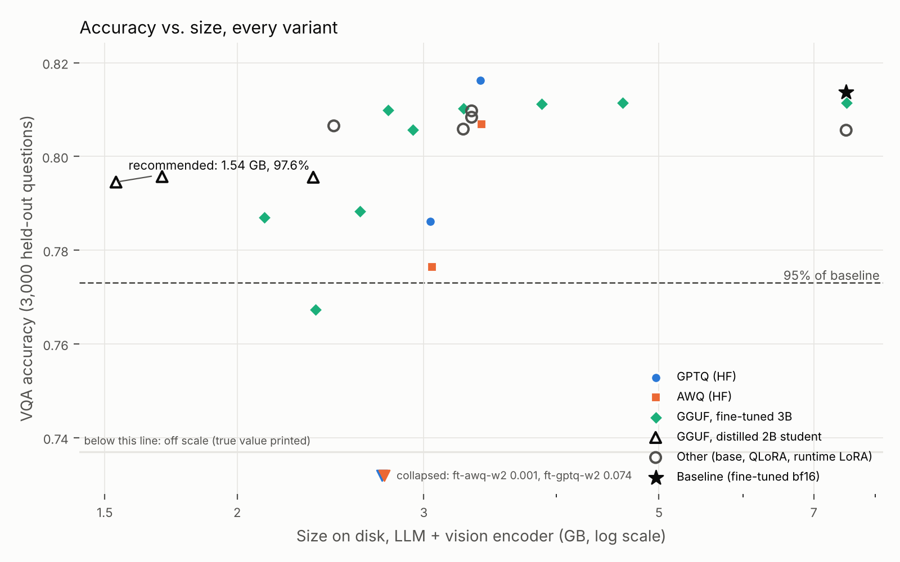
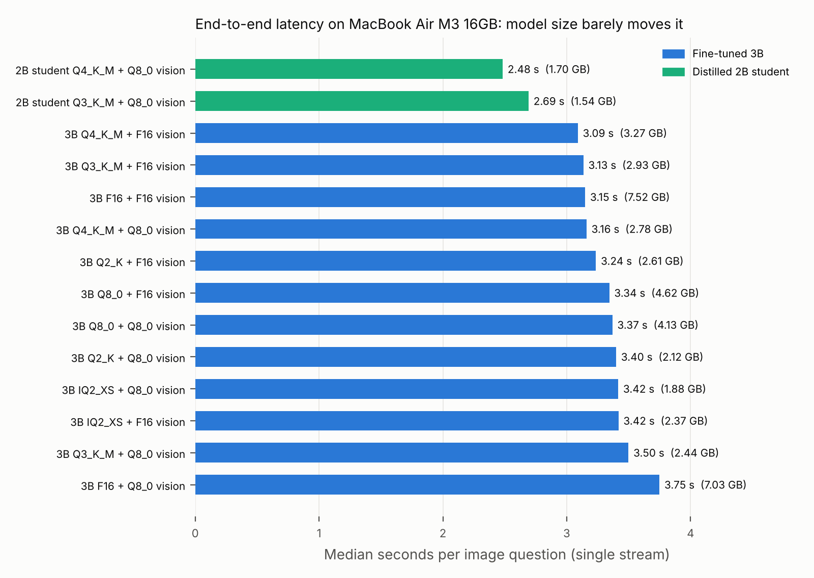

# Compressing a Fine-Tuned Vision-Language Model for On-Device Deployment

**Dev Sharma, November 2026**

## Summary

I fine-tuned Qwen2.5-VL-3B-Instruct with LoRA on VQAv2, then compressed it with GPTQ, AWQ, GGUF (llama.cpp) and knowledge distillation, and measured every variant against the full-precision fine-tuned model on 3,000 held-out questions. The recommended configuration, a distilled Qwen2-VL-2B student at GGUF Q3_K_M with an 8-bit vision encoder, **shrinks the model 4.9x (7.51 GB to 1.54 GB) while keeping 97.6% of VQA accuracy**, and runs on a MacBook Air M3 at **41.6 tokens/s decode and 2.7 s per image question**. Keeping the original 3B architecture, the best result is **3.5x smaller (2.12 GB) at 96.7%**.

## Setup

- **Model:** Qwen2.5-VL-3B-Instruct (its vision encoder alone is about 1.3 GB at F16). Distillation student: Qwen2-VL-2B-Instruct, which shares the Qwen2 tokenizer.
- **Data:** VQAv2 validation, partitioned by image so eval images never appear in training or calibration: 20,000 training questions, 512 calibration, 3,000 eval.
- **Metric:** standard VQA accuracy (10 human answers, leave-one-out, official answer normalization). Prompt: Qwen's VQAv2 prompt, "Answer the question using a single word or phrase." Images capped at 512 visual tokens in every backend.
- **Fine-tuning:** LoRA r=16 on the language model only (vision encoder frozen), 1 epoch, 1,250 steps. Base 0.8056 to fine-tuned 0.8137 (+0.81 points).
- **Compression:** GPTQ and AWQ (llm-compressor) at 4, 3 and 2 bits; GGUF Q8_0 down to IQ2_XS with an importance matrix from the same 512 calibration questions; vision encoder at F16 or Q8_0. Distillation: 0.7 x KL (T=2) + 0.3 x cross-entropy on answer tokens, LoRA r=64 on the student.
- **Hardware:** training, quantization and accuracy sweeps on one NVIDIA A40 (RunPod). On-device numbers on a MacBook Air M3, 16 GB, llama.cpp `52c9bad` with Metal.

## Findings

**1. At 2 bits, the method decides whether the model works at all.** At 4 bits all three methods hold: GPTQ 100.3%, GGUF Q4_K_M 99.6%, AWQ 99.2% of baseline. At 3 bits GGUF Q3_K_M keeps 99.0% against 96.6% (GPTQ) and 95.4% (AWQ). At 2 bits GPTQ collapses to 9.1% and AWQ to 0.1%, while GGUF Q2_K keeps 96.9%. llama.cpp's K-quants give sensitive tensors more bits and use the importance matrix to choose; uniform 2-bit weights with group size 64 do not survive in a 3B model.

**2. GPTQ/AWQ hit a size floor.** They leave the vision encoder (~1.3 GB), the embedding table and the output layer in bf16, so going from 4 to 2 bits saves only 0.65 GB (3.39 to 2.74 GB). GGUF quantizes those layers too, which is how it reaches 2.12 GB.

**3. The accuracy cliff is between Q2_K and IQ2_XS.** F16 0.8115, Q8_0 0.8115, Q6_K 0.8112, Q4_K_M 0.8103, Q3_K_M 0.8056, Q2_K 0.7883, IQ2_XS 0.7674. Everything down to Q3_K_M is within about 1 point of full precision.

**4. Counting breaks first.** At Q2_K the loss is 3.3 points on "number" questions, 2.7 on "other" and 2.1 on yes/no; IQ2_XS follows the same order (5.7, 5.2, 3.5).

**5. When you add LoRA doesn't matter at 4-bit.** Merging LoRA before quantizing (99.6%), applying the bf16-trained adapter at runtime on a quantized base (99.3%), and applying a QLoRA-trained adapter at runtime (99.5%) all land within 0.3 points. The runtime adapter is only ~60 MB, so one quantized base can serve several task adapters.

**6. The vision encoder tolerates 8-bit, but it isn't free on a Mac.** Q8_0 vision costs 0.04 to 0.13 points and saves 0.49 GB, but on the M3 it was slightly slower at five of six levels (for example 3.16 s vs 3.09 s at Q4_K_M), since dequantizing during compute-heavy image encoding costs more than the smaller file saves.

**7. Distill smaller beat crush bigger, but distillation itself added little.** The 2B student at Q3_K_M (1.54 GB, 97.6%) beats the 3B at Q2_K with 8-bit vision (2.12 GB, 96.7%): smaller and more accurate. But knowledge distillation raised the student only 0.15 points over the un-distilled Qwen2-VL-2B (0.7960 to 0.7975). The win comes from starting with a strong smaller model, not from the distillation step.

**8. On a laptop, quantization buys memory, not latency.** Every 3B variant from F16 (7.52 GB) to IQ2_XS (1.88 GB) answers an image question in a median 3.1 to 3.7 s. Each question is about 385 tokens, mostly image tokens, so time goes to image encoding and prompt processing, which are compute-bound; answers are only 1 to 3 tokens, so faster decoding barely shows. The student, with a smaller vision encoder and language model, is the only variant clearly faster (2.5 to 2.7 s). The real latency levers are fewer visual tokens and a smaller vision encoder.

**9. Decode speed does scale with size.** llama-bench decode on the M3: F16 14.7, Q8_0 18.1, Q4_K_M 18.5, Q3_K_M 22.4, Q2_K 39.9, IQ2_XS 46.6 tokens/s; the student 41.6 (Q3_K_M) and 48.0 (Q4_K_M). That matters for longer answers such as captions, not for one-word VQA.

**10. On a GPU, 4-bit pays off directly.** In vLLM with packed 4-bit kernels on the A40, GPTQ-W4 uses 3.31 GiB of weight memory versus 7.16 GiB for bf16 (2.2x less), decodes at 183.6 versus 77.5 tokens/s (2.4x faster), and matches baseline accuracy (0.8165 vs 0.8147). Batched throughput is unchanged (~14.7 questions/s) because batched work is compute-bound.

**11. The laptop matches the GPU.** The recommended model scores 0.7976 on the MacBook versus 0.7945 on the A40 (+0.31 points) over the same 3,000 questions.

## Recommendation

**Deploy the distilled 2B student at GGUF Q3_K_M with a Q8_0 vision encoder:** 1.54 GB, 97.6% of baseline accuracy (98.0% measured on the Mac), 2.7 s per image question and 41.6 tokens/s on a MacBook Air M3. It is the smallest variant above the 95% threshold and also the fastest.

If the fine-tuned 3B itself must ship: **Q4_K_M with Q8_0 vision** (2.78 GB, 99.5%) when accuracy matters most, or **Q2_K with Q8_0 vision** (2.12 GB, 96.7%) when memory is tight. For GPU serving, use **GPTQ-W4 in vLLM**. Avoid GPTQ/AWQ below 4 bits.

## Limitations

- The eval is an image-disjoint split of VQAv2 validation, not the official test-dev server, so absolute numbers are not leaderboard-comparable.
- One fine-tuning run and one seed per variant. On 3,000 questions, differences under about 1 point should be read as ties.
- Laptop latency used the first 300 eval questions, a slightly harder subset (accuracies around 0.77 instead of 0.81), so those rows compare variants with each other only.
- The MacBook Air is fanless and throttles as it heats up; models were benchmarked one after another, so small tokens/s differences are noise.
- The 2-bit GPTQ/AWQ collapse is for one recipe (group size 64, 256 calibration samples); stronger 2-bit methods might do better.
- The GGUF importance matrix uses text-only calibration.
- Peak memory is reported as file size: on Apple Silicon, process RSS does not count the GPU buffers holding the weights.

## Reproduce

`bash run_pod.sh` on a 48 GB GPU, copy the GGUFs to the laptop, `bash run_mac.sh`, then `python scripts/10_demo.py` for the live demo. Full results: [`results/REPORT.md`](../results/REPORT.md).
