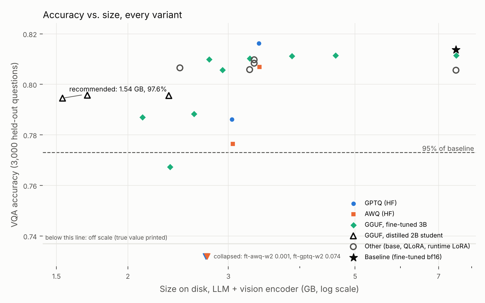
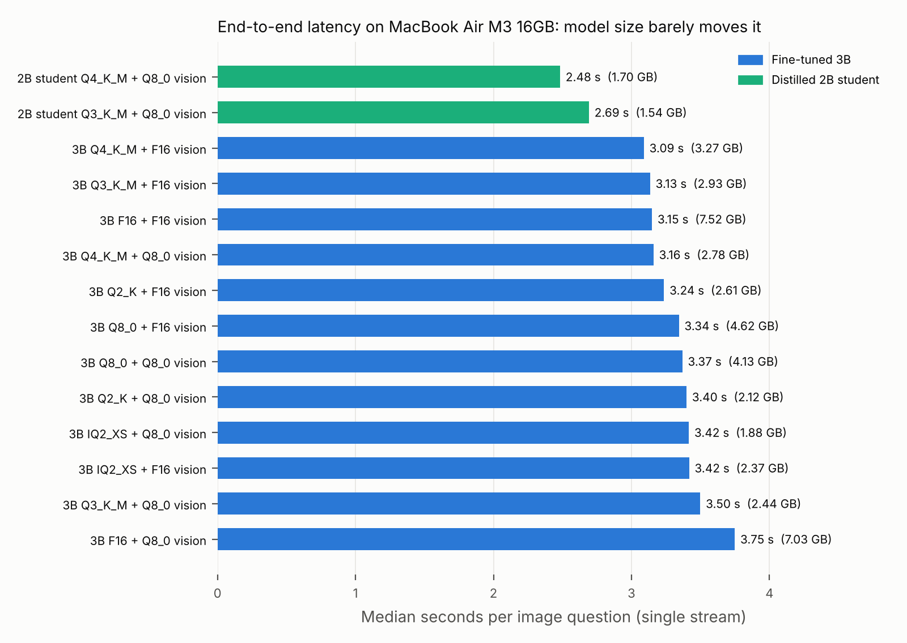

# VLM compression results: Qwen/Qwen2.5-VL-3B-Instruct

Baseline (full-precision fine-tuned, `ft-bf16`): VQA acc **0.8137** on 3000 held-out questions, 7.51 GB on disk.

Un-fine-tuned base (`base-bf16`): VQA acc 0.8056 (LoRA delta +0.81 pts).

## Headline

> Shrank the model **4.9x** (7.51 GB -> 1.54 GB, LLM + vision projector) retaining **97.6%** of VQA accuracy, running at 41.6 tokens/s on MacBook Air M3 16GB. Variant: `student-kd-Q3_K_M-mmprojQ8`.

## All variants

| Variant | Backend | Family | Size (GB) | Compression | VQA acc | % of baseline | yes/no | number | other | decode tok/s | prefill tok/s |
|---|---|---|---:|---:|---:|---:|---:|---:|---:|---:|---:|
| ft-bf16 | hf | bf16 | 7.509 | 1.0x | 0.8137 | 100.0% | 0.944 | 0.718 | 0.742 | - | - |
| base-bf16 | hf | bf16 | 7.509 | 1.0x | 0.8056 | 99.0% | 0.944 | 0.706 | 0.729 | - | - |
| student-kd-bf16 | hf | bf16 | 4.418 | 1.7x | 0.7975 | 98.0% | 0.931 | 0.697 | 0.724 | - | - |
| student-base-bf16 | hf | bf16 | 4.418 | 1.7x | 0.7960 | 97.8% | 0.931 | 0.714 | 0.717 | - | - |
| ft-awq-w4 | hf | AWQ | 3.402 | 2.2x | 0.8068 | 99.2% | 0.937 | 0.716 | 0.733 | - | - |
| ft-gptq-w4 | hf | GPTQ | 3.391 | 2.2x | 0.8162 | 100.3% | 0.946 | 0.727 | 0.743 | - | - |
| ft-awq-w3 | hf | AWQ | 3.052 | 2.5x | 0.7764 | 95.4% | 0.923 | 0.690 | 0.690 | - | - |
| ft-gptq-w3 | hf | GPTQ | 3.044 | 2.5x | 0.7861 | 96.6% | 0.926 | 0.677 | 0.710 | - | - |
| ft-awq-w2 | hf | AWQ | 2.752 | 2.7x | 0.0005 | 0.1% | 0.001 | 0.000 | 0.000 | - | - |
| ft-gptq-w2 | hf | GPTQ | 2.741 | 2.7x | 0.0744 | 9.1% | 0.136 | 0.021 | 0.042 | - | - |
| qlora-nf4 | hf | QLORA | 2.467 | 3.0x | 0.8065 | 99.1% | 0.940 | 0.724 | 0.729 | - | - |
| ft-F16 | llama.cpp | GGUF | 7.517 | 1.0x | 0.8115 | 99.7% | 0.943 | 0.721 | 0.738 | 14.7 | 502.1 |
| ft-Q8_0 | llama.cpp | GGUF | 4.624 | 1.6x | 0.8115 | 99.7% | 0.941 | 0.725 | 0.737 | 18.1 | 439.2 |
| ft-Q6_K | llama.cpp | GGUF | 3.877 | 1.9x | 0.8112 | 99.7% | 0.943 | 0.721 | 0.737 | 19.8 | 294.2 |
| base-Q4_K_M+qlora | llama.cpp | GGUF + runtime LoRA | 3.328 | 2.3x | 0.8097 | 99.5% | 0.949 | 0.713 | 0.731 | - | - |
| base-Q4_K_M+lora | llama.cpp | GGUF + runtime LoRA | 3.328 | 2.3x | 0.8084 | 99.3% | 0.940 | 0.720 | 0.734 | - | - |
| base-Q4_K_M | llama.cpp | GGUF | 3.268 | 2.3x | 0.8058 | 99.0% | 0.948 | 0.706 | 0.726 | - | - |
| ft-Q4_K_M | llama.cpp | GGUF | 3.268 | 2.3x | 0.8103 | 99.6% | 0.940 | 0.726 | 0.736 | 18.5 | 243.3 |
| ft-Q3_K_M | llama.cpp | GGUF | 2.929 | 2.6x | 0.8056 | 99.0% | 0.946 | 0.698 | 0.729 | 22.4 | 378.1 |
| ft-Q4_K_M-mmprojQ8 | llama.cpp | GGUF | 2.778 | 2.7x | 0.8098 | 99.5% | 0.942 | 0.727 | 0.733 | 18.5 | 243.3 |
| ft-Q2_K | llama.cpp | GGUF | 2.613 | 2.9x | 0.7883 | 96.9% | 0.924 | 0.685 | 0.715 | 39.9 | 398.0 |
| ft-IQ2_XS | llama.cpp | GGUF | 2.370 | 3.2x | 0.7674 | 94.3% | 0.910 | 0.661 | 0.690 | 46.6 | 454.4 |
| student-kd-Q8_0-mmprojQ8 | llama.cpp | GGUF (distilled student) | 2.359 | 3.2x | 0.7956 | 97.8% | 0.928 | 0.689 | 0.725 | - | - |
| ft-Q2_K-mmprojQ8 | llama.cpp | GGUF | 2.123 | 3.5x | 0.7869 | 96.7% | 0.920 | 0.681 | 0.716 | 39.9 | 398.0 |
| student-kd-Q4_K_M-mmprojQ8 | llama.cpp | GGUF (distilled student) | 1.699 | 4.4x | 0.7957 | 97.8% | 0.931 | 0.688 | 0.723 | 48.0 | 895.7 |
| mac-student-kd-Q3_K_M-mmprojQ8-full | llama.cpp | GGUF (Mac re-run) | 1.537 | 4.9x | 0.7976 | 98.0% | 0.936 | 0.697 | 0.721 | 41.6 | 777.0 |
| student-kd-Q3_K_M-mmprojQ8 | llama.cpp | GGUF (distilled student) | 1.537 | 4.9x | 0.7945 | 97.6% | 0.937 | 0.677 | 0.720 | 41.6 | 777.0 |

## End-to-end latency (single stream, image + question -> answer)

| Variant | Device | n | Size (GB) | median s | p90 s | median prefill tokens |
|---|---|---:|---:|---:|---:|---:|
| mac-student-kd-Q4_K_M | MacBook Air M3 16GB | 300 | 1.70 | 2.483 | 2.893 | 385 |
| mac-student-kd-Q3_K_M | MacBook Air M3 16GB | 300 | 1.54 | 2.692 | 3.123 | 385 |
| mac-ft-Q4_K_M-mmprojF16 | MacBook Air M3 16GB | 300 | 3.27 | 3.090 | 3.649 | 385 |
| mac-ft-Q3_K_M-mmprojF16 | MacBook Air M3 16GB | 300 | 2.93 | 3.135 | 3.521 | 385 |
| mac-ft-F16-mmprojF16 | MacBook Air M3 16GB | 300 | 7.52 | 3.149 | 3.486 | 385 |
| mac-ft-Q4_K_M-mmprojQ8_0 | MacBook Air M3 16GB | 300 | 2.78 | 3.160 | 3.575 | 385 |
| mac-ft-Q2_K-mmprojF16 | MacBook Air M3 16GB | 300 | 2.61 | 3.236 | 3.780 | 385 |
| mac-ft-Q8_0-mmprojF16 | MacBook Air M3 16GB | 300 | 4.62 | 3.344 | 4.002 | 385 |
| mac-ft-Q8_0-mmprojQ8_0 | MacBook Air M3 16GB | 300 | 4.13 | 3.369 | 3.888 | 385 |
| mac-ft-Q2_K-mmprojQ8_0 | MacBook Air M3 16GB | 300 | 2.12 | 3.399 | 3.919 | 385 |
| mac-ft-IQ2_XS-mmprojQ8_0 | MacBook Air M3 16GB | 300 | 1.88 | 3.416 | 4.024 | 385 |
| mac-ft-IQ2_XS-mmprojF16 | MacBook Air M3 16GB | 300 | 2.37 | 3.418 | 3.868 | 385 |
| mac-ft-Q3_K_M-mmprojQ8_0 | MacBook Air M3 16GB | 300 | 2.44 | 3.499 | 3.986 | 385 |
| mac-ft-F16-mmprojQ8_0 | MacBook Air M3 16GB | 300 | 7.03 | 3.749 | 4.358 | 385 |

Peak RSS is not reported: on Apple Silicon, Metal buffers holding the weights are not counted in process RSS, so it understates memory. File size is the memory figure to use.

## GPU serving with real 4-bit kernels (vLLM)

| Variant | GPU | n | VQA acc | weight memory (GiB) | single-stream median s | p90 s | decode tok/s | throughput (q/s) |
|---|---|---:|---:|---:|---:|---:|---:|---:|
| vllm-ft-awq-w4 | NVIDIA A40 | 3000 | 0.8098 | 3.32 | 0.094 | 0.103 | 179.3 | 14.7 |
| vllm-ft-bf16 | NVIDIA A40 | 3000 | 0.8147 | 7.16 | 0.105 | 0.120 | 77.5 | 14.9 |
| vllm-ft-gptq-w4 | NVIDIA A40 | 3000 | 0.8165 | 3.31 | 0.093 | 0.102 | 183.6 | 14.6 |

2- and 3-bit GPTQ/AWQ have no vLLM (or Metal) kernels, so those rows are accuracy-only.

## Key comparisons

### 1. Method vs bit-width (accuracy, % of baseline)

| Bits | GPTQ | AWQ | GGUF (closest type) |
|---|---|---|---|
| 4 | 0.8162 (100.3%) | 0.8068 (99.2%) | ft-Q4_K_M: 0.8103 (99.6%) |
| 3 | 0.7861 (96.6%) | 0.7764 (95.4%) | ft-Q3_K_M: 0.8056 (99.0%) |
| 2 | 0.0744 (9.1%) | 0.0005 (0.1%) | ft-Q2_K: 0.7883 (96.9%) |
| 2 | 0.0744 (9.1%) | 0.0005 (0.1%) | ft-IQ2_XS: 0.7674 (94.3%) |

GGUF K-quants mix precisions per tensor, so their effective bits/weight sit above the nominal number; compare by the Size column in the main table, not by the name.

### 2. Merge-then-quantize vs quantize-then-adapt (4-bit)

| Recipe | Variant | Accuracy |
|---|---|---|
| merge LoRA in bf16, then quantize | ft-Q4_K_M | 0.8103 (99.6%) |
| quantize base, apply bf16-trained LoRA at runtime | base-Q4_K_M+lora | 0.8084 (99.3%) |
| quantize base, apply QLoRA-trained LoRA at runtime | base-Q4_K_M+qlora | 0.8097 (99.5%) |
| QLoRA as trained (NF4 base + adapter, HF) | qlora-nf4 | 0.8065 (99.1%) |
| quantized base, no adapter (reference) | base-Q4_K_M | 0.8058 (99.0%) |

### 3. Does the vision encoder tolerate 8-bit?

| LLM quant | mmproj F16 | mmproj Q8_0 | delta | size saved (GB) |
|---|---|---|---|---|
| Q8_0 | 0.8115 (99.7%) | not run | - | - |
| Q6_K | 0.8112 (99.7%) | not run | - | - |
| Q4_K_M | 0.8103 (99.6%) | 0.8098 (99.5%) | -0.04 pts | 0.49 |
| Q3_K_M | 0.8056 (99.0%) | not run | - | - |
| Q2_K | 0.7883 (96.9%) | 0.7869 (96.7%) | -0.13 pts | 0.49 |
| IQ2_XS | 0.7674 (94.3%) | not run | - | - |

### 4. Distill smaller or crush bigger? (similar bytes)

| Variant | Size (GB) | Accuracy |
|---|---:|---|
| student-kd-Q3_K_M-mmprojQ8 | 1.54 | 0.7945 (97.6%) |
| student-kd-Q4_K_M-mmprojQ8 | 1.70 | 0.7957 (97.8%) |
| ft-Q2_K-mmprojQ8 | 2.12 | 0.7869 (96.7%) |

KD gain on the student (bf16): +0.15 pts; student vs teacher (bf16): -1.62 pts.

### 5. Where the accuracy cliff is (GGUF ladder, mmproj F16)

F16 0.8115 -> Q8_0 0.8115 -> Q6_K 0.8112 -> Q4_K_M 0.8103 -> Q3_K_M 0.8056 -> Q2_K 0.7883 -> IQ2_XS 0.7674

Largest single drop: ft-Q2_K -> ft-IQ2_XS (2.09 pts).

### 6. Which questions break first at 2-bit (per answer type, change vs baseline)

| Variant | yes/no | number | other |
|---|---|---|---|
| ft-gptq-w2 | -80.8 pts | -69.6 pts | -69.9 pts |
| ft-awq-w2 | -94.3 pts | -71.8 pts | -74.1 pts |
| ft-Q2_K | -2.1 pts | -3.3 pts | -2.7 pts |
| ft-IQ2_XS | -3.5 pts | -5.7 pts | -5.2 pts |

### 7. Cross-device check (same GGUF, pod GPU vs laptop)

- mac-student-kd-Q3_K_M-mmprojQ8-full: 0.7976 on MacBook Air M3 16GB vs 0.7945 on the pod (+0.31 pts)

## Notes

- vLLM rows use real packed 4-bit kernels on the pod GPU; they are GPU serving numbers, not on-device.
- Size = bytes on disk of everything needed to run (HF: all safetensors; GGUF: LLM + mmproj [+ LoRA]).
- HF GPTQ/AWQ accuracy is measured with weights dequantized at load (compressed-tensors); their size is the packed checkpoint.
- decode/prefill tok/s come from llama-bench (text-only, pp512/tg128) on the device named in results/bench. A fanless laptop throttles as it heats up, so treat small tok/s differences between variants as noise.
- Eval split: image-disjoint partition of VQAv2 val (see data/splits.json); not comparable to the official test-dev leaderboard.
